<p align="center">
  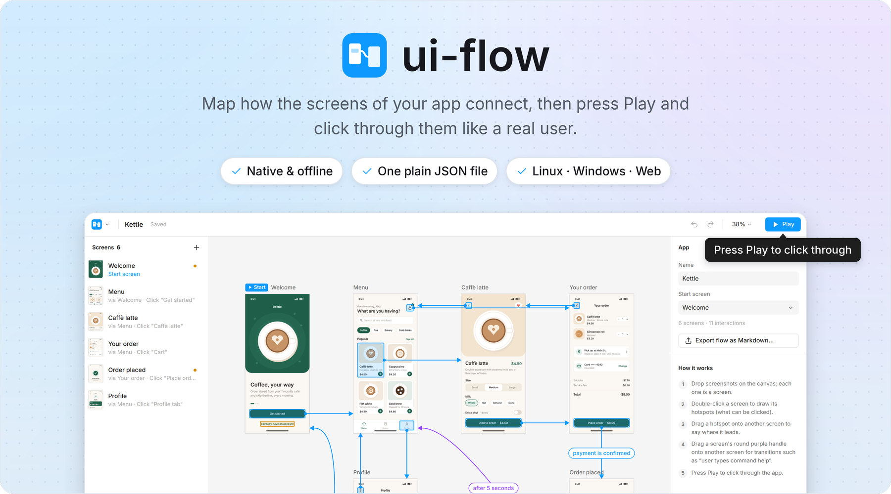
</p>

<p align="center">
  <a href="#how-it-works"><b>How it works</b></a> &nbsp;·&nbsp;
  <a href="#download-and-run"><b>Download and run</b></a> &nbsp;·&nbsp;
  <a href="#controls"><b>Controls</b></a> &nbsp;·&nbsp;
  <a href="#file-format"><b>File format</b></a> &nbsp;·&nbsp;
  <a href="#building"><b>Building</b></a>
</p>

ui-flow is a small, local, Figma-like tool for mapping how the screens of an app connect: drop in
screenshots, mark what can be clicked, draw arrows between screens, then press **Play** and click
through the app as a user would. C++17 + Qt 6 / QML, for Linux and Windows (x64 and arm64) and the
web. No account, no server.

## How it works

<p align="center">
  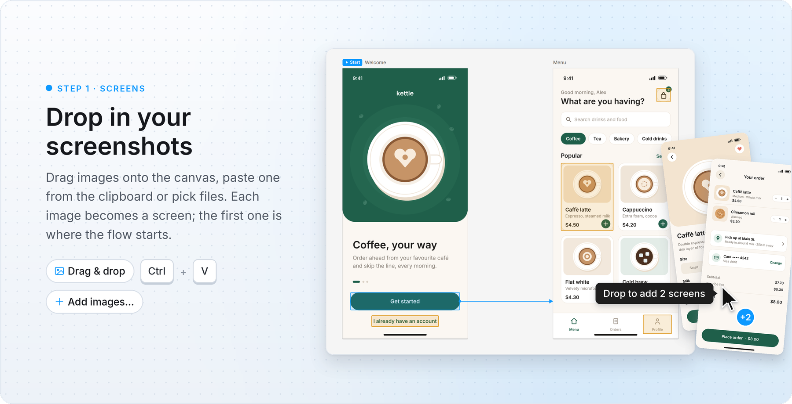
</p>
<p align="center">
  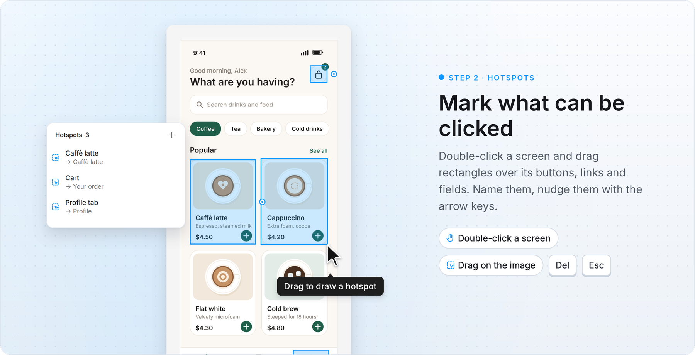
</p>
<p align="center">
  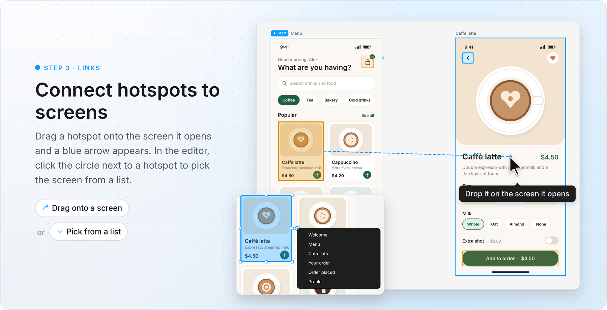
</p>
<p align="center">
  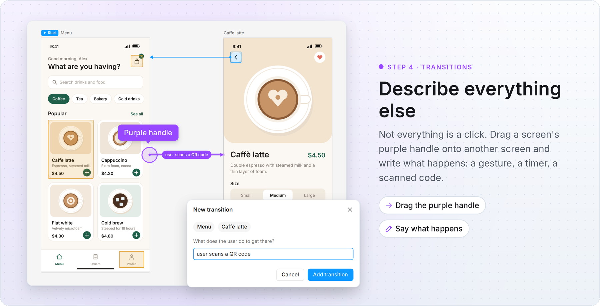
</p>
<p align="center">
  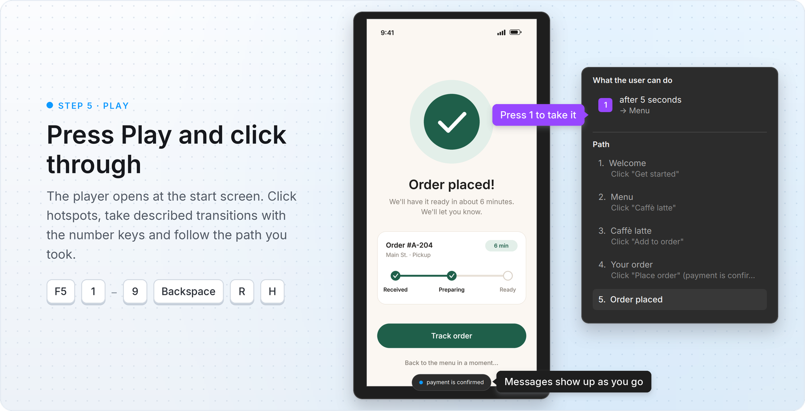
</p>

## Also in the box

<p align="center">
  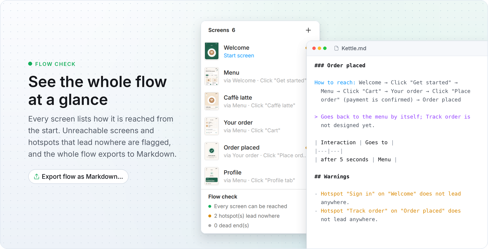
</p>
<p align="center">
  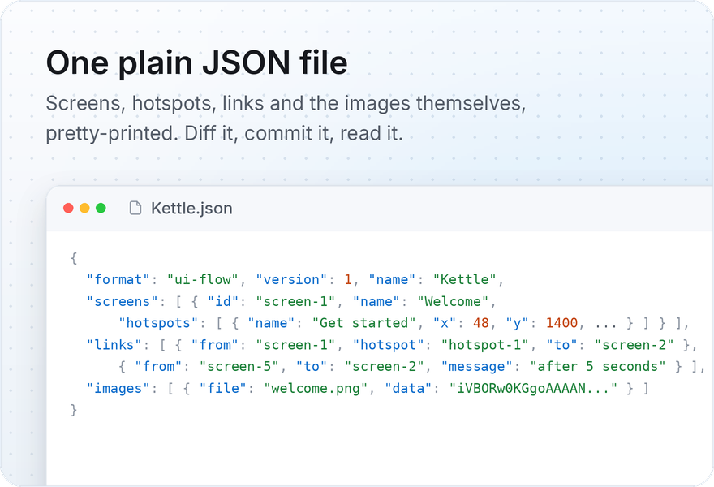
  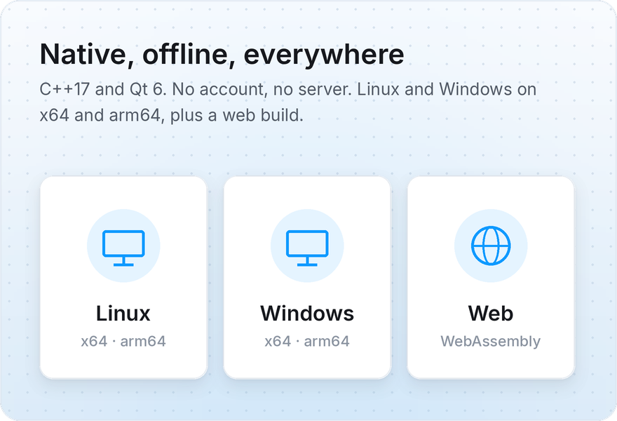
</p>
<p align="center">
  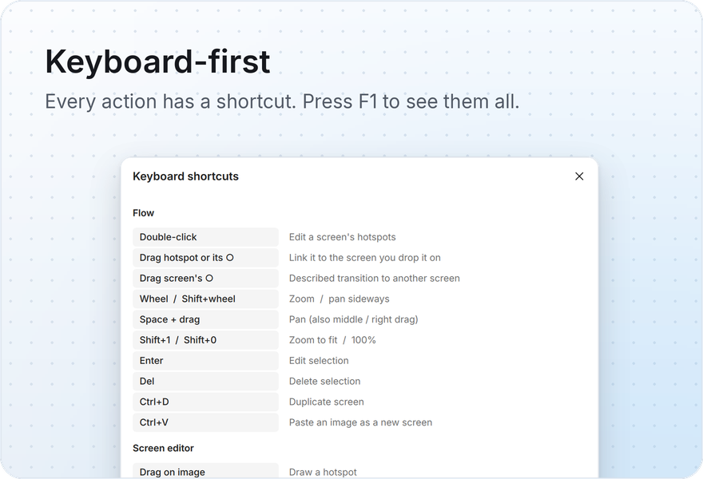
  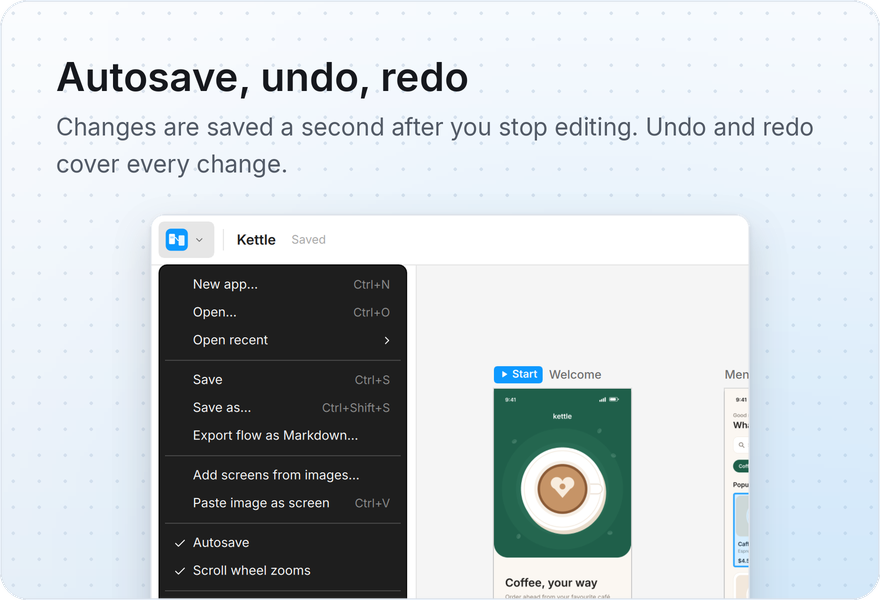
</p>

The app in these pictures is *Kettle*, a made-up coffee ordering app drawn by
[scripts/readme-banners/](scripts/readme-banners/); `./run.sh --banners` regenerates them.

## Download and run

`./run.sh` builds everything into `dist/` (see [Building](#building)).

* **Windows** (10 1809+ or 11, x64 or ARM64): unzip, run `ui-flow.exe`. Needs the
  [Microsoft Visual C++ Redistributable 2015-2022](https://learn.microsoft.com/cpp/windows/latest-supported-vc-redist)
  for the same architecture (most PCs have it already).
* **Linux** (x64 or arm64, glibc 2.34+: Ubuntu 22.04, Debian 12, Fedora 35, RHEL 9 or newer):
  extract and run `./ui-flow`. Works on X11 and Wayland. Needs the usual desktop libraries
  (OpenGL/EGL, fontconfig, xkbcommon; on X11 also `libxcb-cursor0`), which desktop
  distributions install by default.
* **Web**: see [Web version](#web-version).

## Controls

Press `F1` in the app for the same list.

<details>
<summary><b>All mouse and keyboard controls</b></summary>
<br>

| Where | Input | Action |
|---|---|---|
| Canvas | drag a screen (title or image) | move it |
| | double-click a screen | edit its hotspots |
| | drag a hotspot, or its circle, onto a screen | link: clicking it opens that screen |
| | drag the purple handle onto a screen | described transition |
| | click / double-click an arrow | select / edit its text |
| | wheel, pinch, `+` / `-` | zoom (turn off *Scroll wheel zooms* in the app menu to make the wheel pan; `Ctrl`+wheel always zooms) |
| | `Shift`+wheel, space+drag, middle or right drag | pan |
| | `Shift+1`, `Shift+0` | zoom to fit, 100% |
| | `Del`, `Enter`, `Ctrl+D`, arrows | delete, edit, duplicate, nudge the selection |
| Editor | drag on the image | draw a hotspot |
| | drag inside / on the handles | move / resize |
| | click the circle right of a hotspot | choose the screen it opens |
| | arrows (`Shift`: 10 px), `Del`, `Esc` | nudge, delete, back to the flow (also from a text field) |
| | drop an image | replace the screen's image (hotspots keep their place) |
| Player | click, `1`-`9` | follow a hotspot / a described transition |
| | `Backspace`, `R`, `H`, `Esc` | back, restart, show hotspots, stop |
| Anywhere | `Ctrl+N` `Ctrl+O` `Ctrl+S` `Ctrl+Z` `Ctrl+Shift+Z` `F5` `Shift+F5` `F1` | new, open, save, undo, redo, play, play from selection, shortcuts |

In the player, clicking where nothing happens briefly highlights the clickable areas. Changes
are saved automatically about a second after you stop editing (*Autosave* in the app menu).

</details>

Command line: `ui-flow [app.json] [--play] [--edit <screen-id>] [--select <id>]
[--size WxH] [--screenshot out.png]`.

## Web version

The same C++/QML app compiled to WebAssembly and drawn into a canvas. `./run.sh -t web` builds it
into `dist/ui-flow-<version>-web/` (plus a `.zip` of it): a static site (`index.html`,
`ui-flow.js`, `ui-flow.wasm`, `qtloader.js`, `favicon.svg`) for any static web server, such as
GitHub Pages, Netlify or nginx. No backend is needed, but it must be served over HTTP: to try it
locally, run `python3 -m http.server` in that folder and open <http://localhost:8000> (opening
the file directly does not work).

<details>
<summary><b>Differences from the desktop app</b></summary>
<br>

* *Open* and *Add images* use the browser's file picker; drag and drop of images and `.json`
  files works.
* *Save* and *Export* download the file, so there is no autosave and no recent files list. The
  page asks for confirmation before you leave it with unsaved changes.
* The browser keeps `Ctrl+N`, `Ctrl+W` and `Ctrl+T` for itself; use the app menu instead.
* It needs WebGL 2 (any current Chrome, Edge, Firefox or Safari with hardware acceleration on).

</details>

## File format

An app is one pretty-printed JSON file: `screens` (with their `hotspots` in image pixels),
`links` (a hotspot or a whole screen → another screen, with an optional `message`) and `images`
(the original files in base64, written last). The full specification is in
[docs/file-format.md](docs/file-format.md), with a JSON Schema in
[docs/ui-flow.schema.json](docs/ui-flow.schema.json) (`./run.sh --test` validates the demo and
files saved by the app against it). `examples/demo.json` is a small sample app
(`./run.sh --demo` regenerates it).

<details>
<summary><b>Example</b></summary>
<br>

```json
{
  "format": "ui-flow", "version": 1, "name": "Demo app", "startScreen": "screen-1",
  "screens": [ { "id": "screen-1", "name": "Login", "image": "img-1", "x": 0, "y": 0, "scale": 0.4265,
                 "hotspots": [ { "id": "hotspot-1", "name": "Sign in", "x": 60, "y": 860, "w": 660, "h": 110 } ] } ],
  "links":   [ { "id": "link-1", "from": "screen-1", "hotspot": "hotspot-1", "to": "screen-2", "message": "" },
               { "id": "link-5", "from": "screen-2", "to": "screen-5", "message": "user types command help" } ],
  "images":  [ { "id": "img-1", "file": "login.png", "mime": "image/png", "width": 780, "height": 1688, "data": "iVBORw0KGgo..." } ]
}
```

</details>

**Markdown export.** *Export flow as Markdown* writes, for every screen, how to reach it from the
start screen (`Login → Click "Sign in" → Home → user types command help → Help`), its
interactions and where it is reached from, followed by warnings (unreachable screens, hotspots
without links).

## Building

Everything builds inside Docker, like `../pico`. The source tree is bind-mounted, not copied.

```sh
./run.sh                    # all targets, Release -> dist/
./run.sh -t windows-x64     # only some: linux-x64, linux-arm64, windows-x64, windows-arm64, web
./run.sh --debug            # Debug build (Windows: console subsystem, DWARF debug info)
./run.sh --test             # unit tests, GUI + interaction tests (screenshots in build/smoke/),
                            # file format check against docs/ui-flow.schema.json
./run.sh --banners          # regenerate the screenshots and images of this README
./run.sh --build            # rebuild the Docker image first
./run.sh --shell            # shell in the build container
```

The first run builds the image (~15 minutes, about 10 GB): it downloads the MSVC CRT and
Windows SDK with [xwin](https://github.com/Jake-Shadle/xwin), which means accepting
Microsoft's license terms for them.

Output, per target: `dist/ui-flow-<version>-<target>.zip` (Windows) or `.tar.gz` (Linux); the web
target writes `dist/ui-flow-<version>-web/` and its `.zip`.

<details>
<summary><b>Toolchains, build trees and building without Docker</b></summary>
<br>

Build trees and the unpacked builds are kept in the Docker volume `ui-flow-build-trees`
(mounted at `/build`; `./run.sh --shell` to look around, `docker volume rm ui-flow-build-trees`
to start over), not in the project folder. That keeps incremental builds fast when the
project sits on a network share, where ninja is also unreliable.

| Target | Compiler | Qt (official binaries via aqtinstall) |
|---|---|---|
| `linux-x64` | gcc 13 | `linux_gcc_64` |
| `linux-arm64` | `aarch64-linux-gnu-g++` 13 + multiarch arm64 libraries | `linux_gcc_arm64` |
| `windows-x64` | clang-cl + lld-link (MSVC ABI), xwin CRT/SDK | `win64_msvc2022_64` |
| `windows-arm64` | clang-cl + lld-link (MSVC ABI), xwin CRT/SDK | `win64_msvc2022_arm64_cross_compiled` |
| `web` | Emscripten 4.0.7 (emsdk) | `wasm_singlethread` (static, no COOP/COEP headers needed) |

`scripts/deploy.py` is a Linux-hosted stand-in for windeployqt/linuxdeployqt: it copies the
Qt libraries, plugins and QML modules the program needs next to it and writes `qt.conf`.

**Without Docker**, with Qt 6.8+ installed: `cmake -B build -DCMAKE_PREFIX_PATH=<qt> && cmake --build build`.
nlohmann/json and stb are fetched by CMake; set `UIFLOW_FONT_DIR` to a directory with
`Inter-Regular/Medium/SemiBold.ttf` to bundle the Inter font (otherwise the system font is used).

**README images.** `./run.sh --banners` builds the Linux app, draws the *Kettle* example app,
drives ui-flow under Xvfb with xdotool to capture each step at 2x, and composes the banners into
`docs/banners/`. The raw captures are kept in `scripts/readme-banners/screenshots/`, so the
banners alone can be redone without building: `./run.sh --banners --render-only`.

</details>

<details>
<summary><b>Project layout</b></summary>
<br>

```
src/core/      document model, JSON file format, flow analysis, Markdown export, geometry
               (plain C++, no Qt: unit-tested in tests/)
src/app/       Qt side: FlowController (the `Doc` QML singleton, list models, image provider),
               main.cpp, qml/ (views and Figma-style controls), icons/
cmake/         toolchain files per target, glibc compatibility header
scripts/       build.sh (container entry), deploy.py, test.sh, make-demo.py, licenses.sh,
               readme-banners/ (screenshots and images of this README)
docs/          file format specification and JSON Schema, banners/ (images of this README)
Dockerfile     the build image; run.sh drives it from the host
```

</details>

## Third-party

Qt 6 (LGPL-3.0, shipped as unmodified shared libraries), nlohmann/json (MIT),
stb_image (MIT / public domain), Inter (SIL OFL 1.1). Notices are in `licenses/` of
every build.
